# Pipeline de la fábrica

```mermaid
flowchart LR
    s0["architect<br/>336 s"]:::ok
    s1["qa-unit<br/>1185 s"]:::ok
    s2["verify unit<br/>25 s"]:::fail
    s3["qa-e2e<br/>817 s"]:::ok
    s4["security<br/>10713 s"]:::ok
    s5["verify unit<br/>218 s"]:::ok
    s6["verify contract<br/>585 s"]:::ok
    s7["verify qa<br/>416 s"]:::fail
    s8["qa-unit<br/>3207 s"]:::ok
    s9["verify unit<br/>185 s"]:::ok
    s10["verify contract<br/>530 s"]:::ok
    s11["verify qa<br/>286 s"]:::ok
    s12["verify e2e<br/>498 s"]:::ok
    s13["verify evaluate<br/>324 s"]:::ok
    s14["qa-style<br/>2004 s"]:::ok
    s15["deploy<br/>74326 s"]:::ok
    s16["verify unit<br/>40 s"]:::ok
    s17["verify contract<br/>38 s"]:::ok
    s18["verify qa<br/>34 s"]:::ok
    s19["verify e2e<br/>135 s"]:::ok
    s20["verify evaluate<br/>25 s"]:::ok
    s21["qa-unit<br/>553 s"]:::ok
    s22["verify unit<br/>34 s"]:::ok
    s23["verify contract<br/>43 s"]:::ok
    s24["verify qa<br/>41 s"]:::ok
    s25["verify e2e<br/>149 s"]:::ok
    s26["verify evaluate<br/>25 s"]:::ok
    s27["verify production<br/>560 s"]:::ok
    s0 --> s1
    s1 --> s2
    s2 --> s3
    s2 --> s4
    s3 --> s5
    s4 --> s5
    s5 --> s6
    s6 --> s7
    s7 --> s8
    s8 --> s9
    s9 --> s10
    s10 --> s11
    s11 --> s12
    s12 --> s13
    s13 --> s14
    s14 --> s15
    s15 --> s16
    s16 --> s17
    s17 --> s18
    s18 --> s19
    s19 --> s20
    s20 --> s21
    s21 --> s22
    s22 --> s23
    s23 --> s24
    s24 --> s25
    s25 --> s26
    s26 --> s27
    classDef ok fill:#d4f4dd,stroke:#1e7b3a
    classDef fail fill:#fde2e2,stroke:#a12a2a
```

| # | Paso | Resultado | Segundos |
| --- | --- | --- | --- |
| 1 | architect | pasó | 336 |
| 2 | qa-unit | pasó | 1185 |
| 3 | verify unit | falló | 25 |
| 4 | qa-e2e | pasó | 817 |
| 5 | security | pasó | 10713 |
| 6 | verify unit | pasó | 218 |
| 7 | verify contract | pasó | 585 |
| 8 | verify qa | falló | 416 |
| 9 | qa-unit | pasó | 3207 |
| 10 | verify unit | pasó | 185 |
| 11 | verify contract | pasó | 530 |
| 12 | verify qa | pasó | 286 |
| 13 | verify e2e | pasó | 498 |
| 14 | verify evaluate | pasó | 324 |
| 15 | qa-style | pasó | 2004 |
| 16 | deploy | pasó | 74326 |
| 17 | verify unit | pasó | 40 |
| 18 | verify contract | pasó | 38 |
| 19 | verify qa | pasó | 34 |
| 20 | verify e2e | pasó | 135 |
| 21 | verify evaluate | pasó | 25 |
| 22 | qa-unit | pasó | 553 |
| 23 | verify unit | pasó | 34 |
| 24 | verify contract | pasó | 43 |
| 25 | verify qa | pasó | 41 |
| 26 | verify e2e | pasó | 149 |
| 27 | verify evaluate | pasó | 25 |
| 28 | verify production | pasó | 560 |
