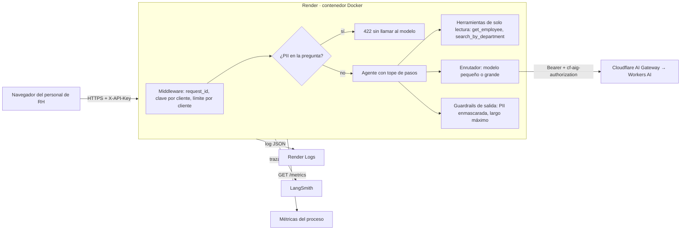
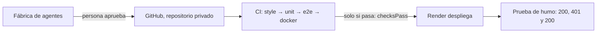

# Arquitectura y despliegue

## El producto en producción

| Pieza | Decisión | Por qué |
| --- | --- | --- |
| API | FastAPI **sin estado**: el historial lo manda el cliente | Escalar es correr más copias; cualquier instancia atiende cualquier petición |
| Agente | Bucle con tope (`AGENT_MAX_STEPS=3`) y mensaje fijo al agotarse | Una pregunta sin solución no gira sin fin ni inventa: en producción, «¿cuántos se llaman Ana?» respondió el mensaje del tope |
| Modelo | Detrás de una interfaz (`complete(messages)`): simulado en desarrollo y pruebas, Cloudflare en producción | Las pruebas no gastan ni dependen de la red; cambiar de proveedor no toca el agente |
| Configuración | Variables de entorno con valores por omisión; un valor inválido impide arrancar | Un mismo contenedor para desarrollo y producción; los secretos fuera del código |
| Documentación de la API | OpenAPI generado por FastAPI en `/docs` | La documentación no se desincroniza del código |

## Desarrollo contra producción

| | Desarrollo | Producción |
| --- | --- | --- |
| `ENVIRONMENT` | `development` | `production` |
| Modelo | Simulado (`fake`), sin red ni costo | Cloudflare (`gateway`) |
| Compliance | Avisa | **Se niega a arrancar** si la configuración es insegura |
| Secretos | `product/.env` local (en `.gitignore`) | Render > Environment, con `sync: false` |

## Del código a producción

El CI detuvo dos publicaciones con problemas reales que las verificaciones locales no veían (opciones distintas de
pylint y una prueba que leía archivos fuera del producto). Render solo despliega cuando las cuatro etapas pasan.

## Concurrencia, escalabilidad y resiliencia

| Propiedad | Cómo se logra | Evidencia |
| --- | --- | --- |
| Concurrencia | API sin estado | 20 peticiones simultáneas con el modelo real: 20 × 200, p95 1465 ms ([concurrencia.md](concurrencia.md)) |
| Protección ante abuso | Límite de 30 peticiones por minuto por cliente | Exactamente 30 × 200 y el resto 429 |
| Salud | `GET /health` sin clave; Render lo consulta cada pocos segundos | Logs de Render |
| Fallas del modelo | Se convierten en `502 model unavailable` con su `request_id`, no en una caída | Diagnóstico del 401 de Cloudflare |
| Escalabilidad horizontal | Sin estado: se pueden correr más instancias | Límite: el límite por cliente y las métricas viven en cada proceso; con varias instancias harían falta un almacén compartido y métricas centralizadas |

## Decisiones de arquitectura

Cada decisión está documentada como ADR en `product/doc/adr/`, con su contexto, la decisión y sus consecuencias.
Las escribió el agente `architect` y una persona las aprobó con el plan antes de escribir código.

| Sesión | ADR | Decisión |
| --- | --- | --- |
| 1 · Arquitectura | 0001 | API sin estado |
| | 0002 | El modelo detrás de una interfaz |
| | 0003 | Bucle del agente con tope de pasos |
| 2 · Observabilidad | 0004 | `request_id` y log JSON |
| | 0005 | Métricas por proceso |
| | 0006 | Trazas opcionales en LangSmith |
| 3 · Costos | 0007 | Enrutamiento de modelos por reglas |
| | 0008 | Modelo real a través de AI Gateway |
| | 0009 | Costo calculado con una tabla de precios |
| 4 · Producción | 0010 | Una clave por cliente |
| | 0011 | Límite de peticiones por proceso |
| | 0012 | Compliance al arrancar y despliegue condicionado al CI |
| Reto · PII | 0013 | Detector de PII local con expresiones regulares |
| | 0014 | Bloquear en la entrada, enmascarar en la salida |
| | 0015 | Auditoría de PII sin los valores |

Dos ADR documentan límites conocidos a propósito: 0005 y 0011 (métricas y límite por proceso) funcionan exactos con
una instancia, y señalan qué haría falta para escalar a varias.
