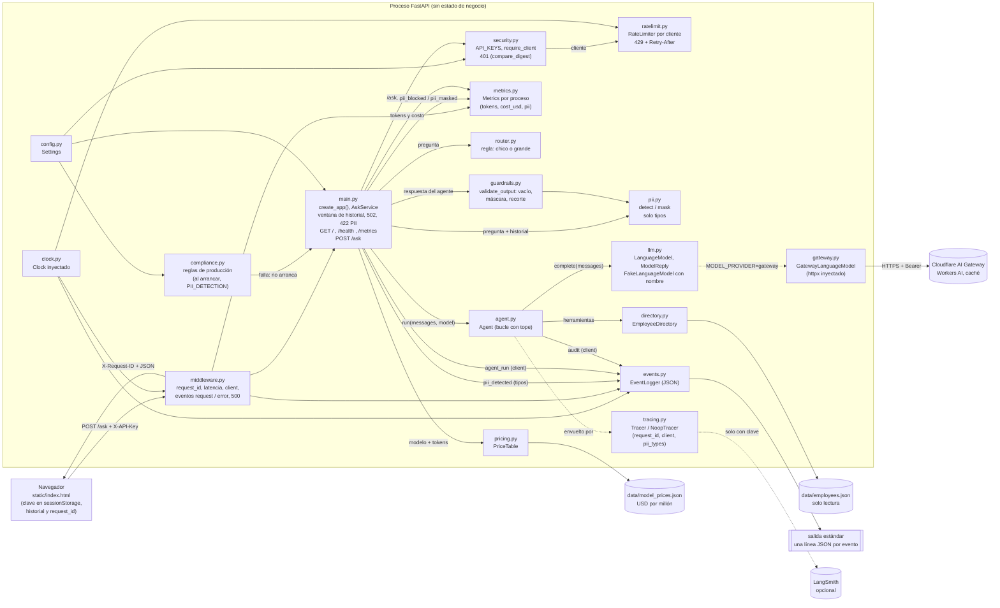
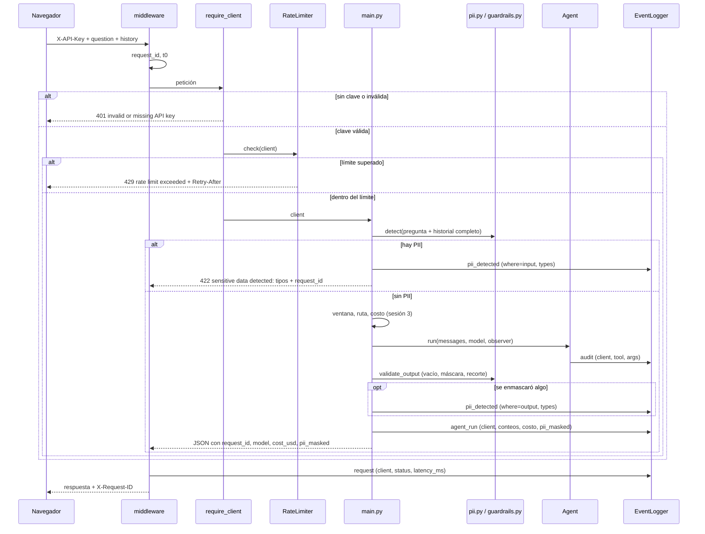
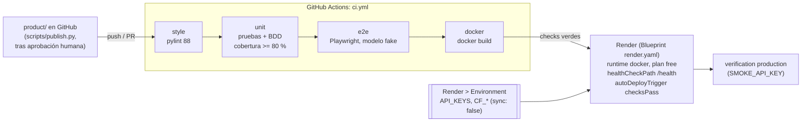

# Arquitectura del HR Assistant

Asistente de Recursos Humanos que responde preguntas sobre empleados desde una página web.
API FastAPI sin estado, un solo agente con bucle con tope y un modelo detrás de una interfaz.
Desde la sesión 2, cada petición se puede rastrear (`request_id`, log JSON, trazas opcionales)
y medir (`GET /metrics`). Desde la sesión 3, cada pregunta elige su modelo con una regla, usa
el modelo real de Workers AI a través de AI Gateway (o el simulado) y reporta su costo. Desde
la sesión 4, solo entra quien tiene clave, cada cliente tiene un límite por minuto, el producto
se niega a arrancar en producción con una configuración insegura, y se publica en Render en un
contenedor solo si el pipeline de CI pasa. Desde el reto de PII, una pregunta con datos
personales se rechaza sin llamar al modelo, la respuesta del modelo se valida y enmascara, y
cada detección se audita solo con sus tipos.

## Componentes

## Flujo de `POST /ask`

Si el gateway falla, la API responde `502 {"detail": "model unavailable", "request_id"}`.
Si algo más truena, el middleware escribe `error` (solo el tipo) y responde
`500 {"detail": "internal error", "request_id"}`. La clave nunca se escribe en ningún evento,
traza ni error. Un dato personal tampoco: el `422`, `pii_detected`, las métricas y las trazas
solo llevan sus tipos.

## Publicación

El contenedor usa `python:3.12-slim`, corre con un usuario sin root y arranca con
`uvicorn app.main:app --host 0.0.0.0 --port ${PORT:-8000}`. Con `ENVIRONMENT=production`,
`compliance.enforce` impide arrancar con una configuración insegura (incluida
`PII_DETECTION` distinta de `true`) y Render conserva la versión anterior.

## Decisiones

- [0001 API sin estado](adr/0001-stateless-api.md)
- [0002 Interfaz de modelo](adr/0002-model-interface.md)
- [0003 Bucle con tope](adr/0003-bounded-agent-loop.md)
- [0004 Id por petición y log JSON](adr/0004-request-id-json-log.md)
- [0005 Métricas por proceso](adr/0005-per-process-metrics.md)
- [0006 Trazas opcionales en LangSmith](adr/0006-optional-langsmith-tracing.md)
- [0007 Enrutamiento por regla entre modelos con nombre](adr/0007-rule-based-model-routing.md)
- [0008 Modelo real vía AI Gateway](adr/0008-ai-gateway-model.md)
- [0009 Costo con tabla de precios local](adr/0009-cost-from-price-table.md)
- [0010 Una clave por cliente](adr/0010-api-key-per-client.md)
- [0011 Límite de peticiones por proceso](adr/0011-per-process-rate-limit.md)
- [0012 Compliance al arrancar y publicación con CI verde](adr/0012-compliance-at-startup-and-gated-deploy.md)
- [0013 Detector de PII local que solo devuelve tipos](adr/0013-local-regex-pii-detector.md)
- [0014 Bloquear la entrada y enmascarar la salida](adr/0014-block-input-mask-output.md)
- [0015 Auditoría de PII sin valores](adr/0015-pii-audit-without-values.md)

## Configuración

Sesión 1: `MODEL_PROVIDER` (`fake` o `gateway`), `AGENT_MAX_STEPS` (`3`), `MAX_QUESTION_CHARS`
(`2000`), `EMPLOYEES_PATH` (`data/employees.json`, relativo a `product/`).

Sesión 2: `SERVICE_NAME` (`hr-assistant`), `SLO_P95_MS` (`2000`), `LANGSMITH_TRACING`
(`false`), `HIDE_INPUTS` / `HIDE_OUTPUTS` (`true`). `LANGSMITH_API_KEY` solo se lee del
entorno y nunca se registra.

Sesión 3: `CF_ACCOUNT_ID`, `CF_GATEWAY_ID` (`default`), `CF_API_TOKEN` (secreto, obligatorias con
`gateway`), `CF_AIG_TOKEN` (secreto, opcional), `MODEL_SMALL`
(`@cf/meta/llama-3.1-8b-instruct-fast`), `MODEL_LARGE`
(`@cf/meta/llama-3.3-70b-instruct-fp8-fast`), `ROUTING` (`true`), `ROUTER_MAX_CHARS` (`80`),
`HISTORY_WINDOW` (`6`), `MODEL_MAX_TOKENS` (`300`), `MODEL_TEMPERATURE` (`0`),
`CACHE_TTL_SECONDS` (`0`), `PRICES_PATH` (`data/model_prices.json`).

Sesión 4: `ENVIRONMENT` (`development`; con `production` se aplican las reglas de compliance),
`API_KEYS` (vacía; `cliente:clave,...`, secreto), `RATE_LIMIT_PER_MINUTE` (`30`).

Reto PII: `PII_DETECTION` (`true`; obligatoria en `production`), `OUTPUT_MAX_CHARS` (`2000`).

Todas aparecen en `.env.example` sin valores secretos. Un valor inválido impide arrancar.
